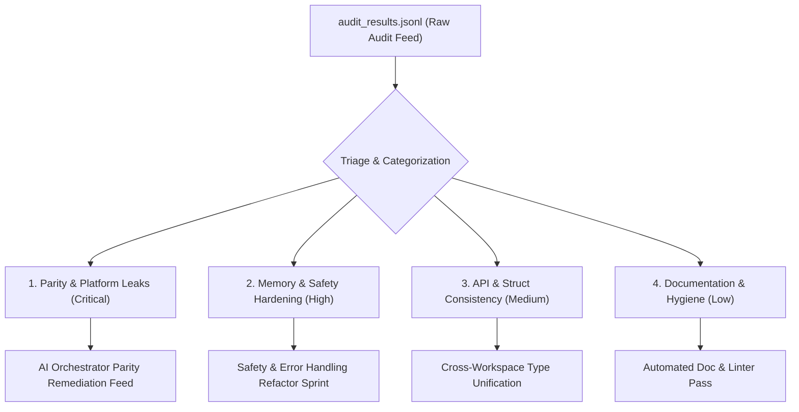

# Comprehensive Unification & Remediation Plan: Utilizing SCMessenger Dual-Pass Audit Data

## Executive Summary

The SCMessenger automated audit system (`audit_system/results_dualpass`) performs a multi-phase, function-by-function evaluation across Quality (readability, docs, error handling, design) and Parity (cross-platform FFI, platform leaks, architectural consistency). 

This plan details how the engineering team and AI Orchestrators will ingest, prioritize, and systematically execute on the completed audit dataset to finalize and unify the SCMessenger codebase toward its **v1.0.0 Worldwide Scale Production GA**.

---

## 1. Audit Data Ingestion & Categorization Architecture

Once the audit reaches 100% completion across all ~5,391 functions, the raw JSONL output (`audit_results.jsonl`) will be parsed and categorized into four primary action buckets:

### Categorization Criteria & Severity Thresholds

1. **Parity & Platform Leaks (P0 - Critical)**:
   - **Target**: `category == "platform_specific_leak"` or `pass_type == "parity"`.
   - **Focus**: Unabstracted mobile-only storage (e.g. hardcoded `MemoryStorage`), missing FFI bridges across iOS/Android, platform-specific thread blocking.
   - **Action**: Feed into the AI Orchestrator dispatch pipeline (`orchestrator_dispatch.json`) to auto-generate Swift (`MeshRepository.swift`) and Kotlin (`MeshRepository.kt`) bridge implementations.

2. **Memory & Safety Hardening (P1 - High)**:
   - **Target**: `category == "todo"` (e.g. placeholder comments regarding persistence), unchecked `unwrap()`, potential panics, or unhandled lock contention.
   - **Focus**: Eliminating all panic vectors in production code paths (`iron_core.rs`, `relay_custody.rs`, `swarm.rs`).
   - **Action**: Batch refactoring into `Result<T, IronCoreError>` propagation.

3. **API & Struct Consistency (P2 - Medium)**:
   - **Target**: `category == "api_design"` or `title == "Struct Copy/Clone Pattern"`.
   - **Focus**: Replacing ad-hoc struct mapping logic with standardized `From<T>` / `Into<T>` trait implementations and unified UniFFI binding types.
   - **Action**: Refactor workspace-bridging structs across `core/src/blocked_bridge.rs`, `contacts_bridge.rs`, and mobile FFI declarations.

4. **Documentation & Hygiene (P3 - Low)**:
   - **Target**: `category == "docs"` or `title == "Missing public API documentation"`.
   - **Focus**: Ensuring 100% `///` doc comment coverage on all exported public APIs and structs for seamless SDK generation.
   - **Action**: Automated doc-fix generator pass.

---

## 2. Integration into SCM-Progress Dashboard

To maintain continuous visual oversight, the `SCM-Progress` visualizer will ingest the `results_dualpass` data via `scripts/verify_wiring.js`:

1. **Audit Completion Progress Bar**: Displays live function completion ratio (`completed_functions / total_functions`, currently **18.7%** / 1,009 of 5,391).
2. **Issue Density Heatmap**: Visualizes issue frequency across Rust modules (`core/src/iron_core.rs`, `core/src/drift/`, `core/src/contacts_bridge.rs`).
3. **Automated Remediation Ticket Generator**: Converts `high` and `critical` audit entries directly into actionable tickets in `HANDOFF/todo/`.

---

## 3. Systematic Remediation Workflow

### Phase A: Automated Parity Patching (AI Orchestration)
- Export all `parity` issues to `data/orchestrator_dispatch.json`.
- Autonomous AI subagents will read each itemized gap, construct missing FFI signatures, and verify cross-platform parity.

### Phase B: Hardening & Code Unification
- Run targeted refactoring passes to eliminate `TODO` items and replace placeholder in-memory storage with persistent `IronCore` storage backends.

### Phase C: Gate Validation & Parity Re-Audit
- Re-run `audit_system` to verify that issue counts trend toward zero and all nodes in the Wiring Dependency Graph achieve 🟢 **Green Confirmed** status.
